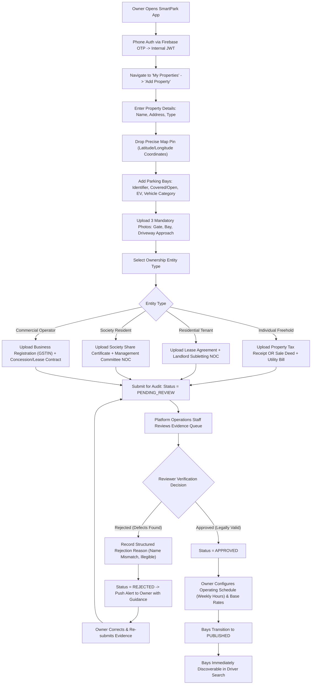
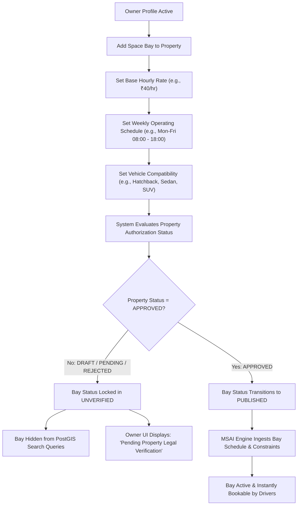
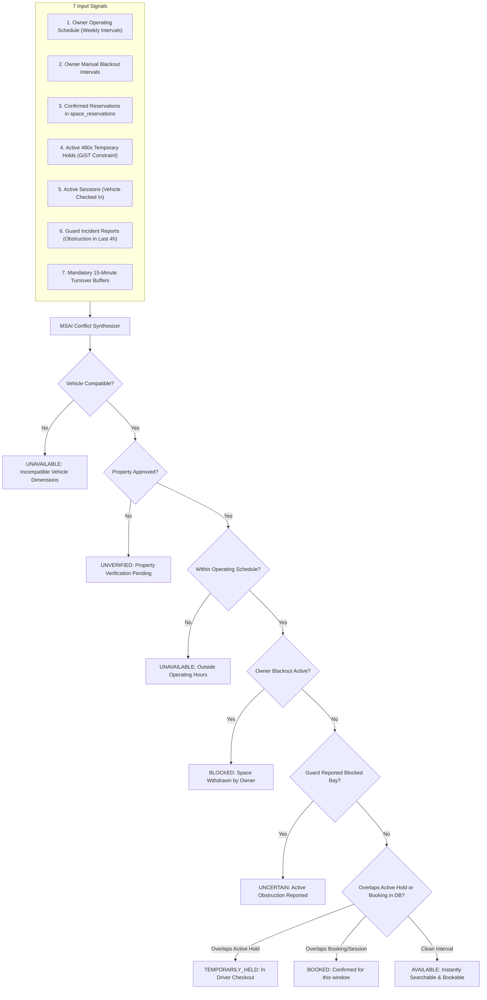
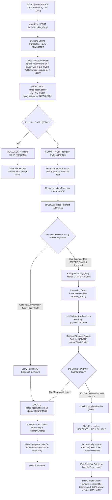
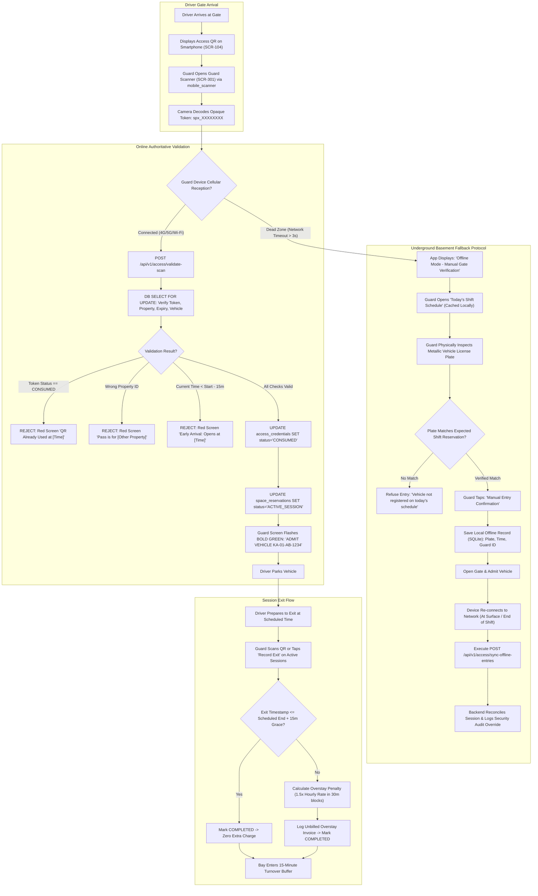
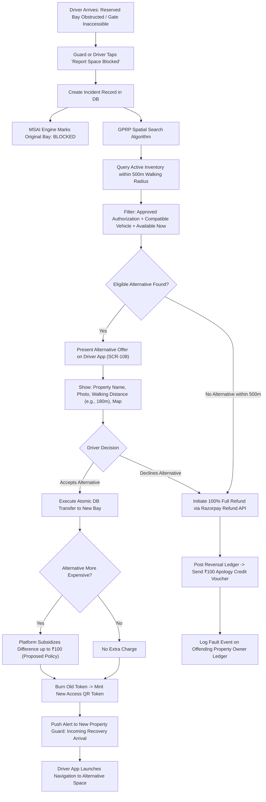
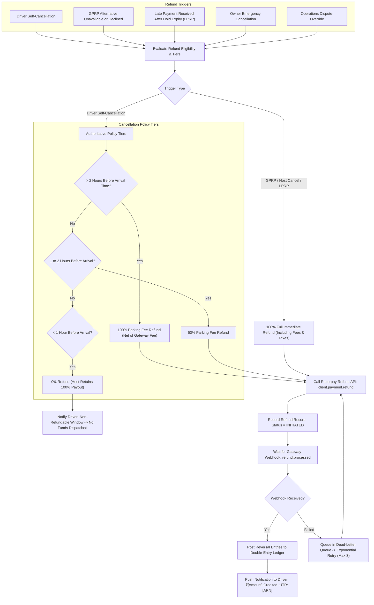
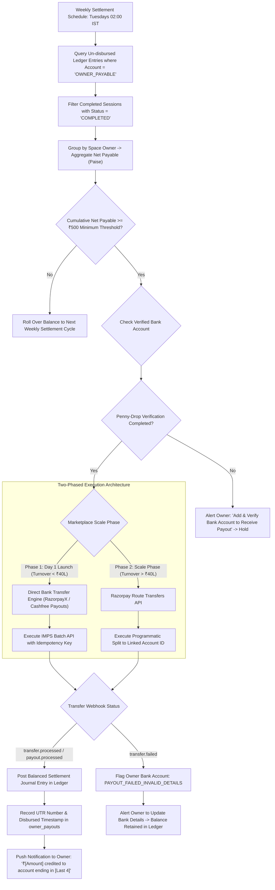
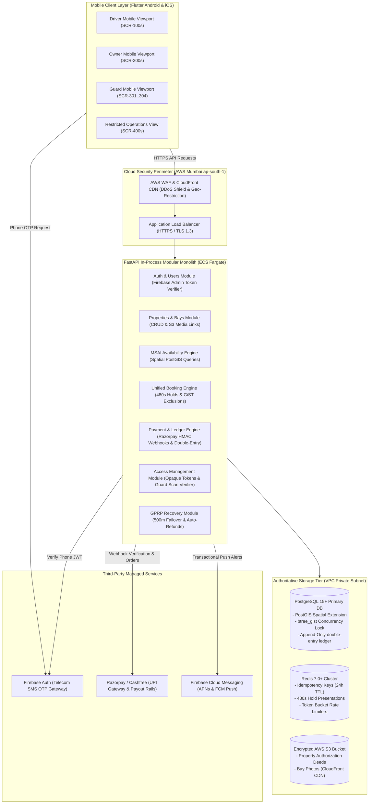

# Gadispot (formerly SmartPark Exchange) — Comprehensive User Flow & System Journey Diagrams

> **Document Version:** 2.3.0  
> **Last Updated:** 2026-10-31  
> **Status:** Approved Architecture Reference (V2.3 Harmonized)  
> **Audience:** Engineering, Product, QA, Architecture  

---

## Table of Contents

1. [Complete Driver Journey](#1-complete-driver-journey)
2. [Owner Onboarding and Property Verification](#2-owner-onboarding-and-property-verification)
3. [Parking Listing Creation and Publication](#3-parking-listing-creation-and-publication)
4. [Availability Calculation — MSAI Engine](#4-availability-calculation--msai-engine)
5. [Booking and Payment Lifecycle (with LPRP Concurrency)](#5-booking-and-payment-lifecycle-with-lprp-concurrency)
6. [QR Entry, Exit and Offline Fallback Lifecycle](#6-qr-entry-exit-and-offline-fallback-lifecycle)
7. [Arrival Failure and Recovery — GPRP Protocol](#7-arrival-failure-and-recovery--gprp-protocol)
8. [Refund Workflow (Authoritative Tiers)](#8-refund-workflow-authoritative-tiers)
9. [Owner Payout Workflow (Route & Batch IMPS Fallback)](#9-owner-payout-workflow-route--batch-imps-fallback)
10. [High-Level Modular Monolith Architecture](#10-high-level-modular-monolith-architecture)

---

## 1. Complete Driver Journey

The driver journey covers the full lifecycle from first opening the app through registration, finding and booking a parking space, completing payment, using the space, and finally rating the experience. The backend is the sole authority for state transitions.

```mermaid
flowchart TD
    A["Open SmartPark App"] --> B{"Authenticated?"}
    B -- No --> C["Enter Phone Number (+91)"]
    C --> D["Receive OTP via Firebase Auth"]
    D --> E["Submit OTP on Handset"]
    E --> F{"Firebase OTP Valid?"}
    F -- No --> G["Show Error / Retry (Rate Limited: 3 req/15m)"]
    G --> C
    F -- Yes --> H["Submit Firebase ID Token to Backend: POST /auth/session"]
    H --> I["Backend Verifies Signature via Admin SDK -> Mints Internal JWT"]
    I --> J{"Profile Complete?"}
    J -- No --> K["Enter Name, Add Vehicle (Plate, Category)"]
    K --> L["Save Profile: POST /vehicles"]
    L --> M["Profile Confirmed"]
    J -- Yes --> M
    B -- Yes --> M

    M --> N["Search Parking: Destination, Arrival Time, Duration, Vehicle"]
    N --> O["Backend PostGIS & MSAI Returns Available Bays"]
    O --> P["Browse Results on Map and Carousel"]
    P --> Q["Select a Space & Review Details (Price, Photos, Amenities)"]
    Q --> R{"Vehicle Category Compatible?"}
    R -- No --> S["Show Incompatibility Alert (e.g., SUV in Compact Bay)"]
    S --> P
    R -- Yes --> T["Tap 'Book This Bay'"]

    T --> U["Backend: POST /bookings/hold (Atomic PostgreSQL GiST Lock)"]
    U --> V{"Exclusion Conflict?"}
    V -- Yes --> W["Show HTTP 409 Conflict: Space Just Claimed"]
    W --> P
    V -- No --> X["Hold Active (480s Countdown) -> Razorpay Order Created"]

    X --> Y["Flutter Launches Razorpay Checkout SDK (UPI Intent)"]
    Y --> Z["Driver Switches to PhonePe/GPay & Authorizes UPI PIN"]
    Z --> AA["Bank Debits Driver Account"]
    AA --> AB["Razorpay Dispatches Webhook: payment.captured"]
    AB --> AC["Backend Verifies Raw HMAC Signature & Amount"]
    AC --> AD["Reservation Transitions to CONFIRMED"]
    AD --> AE["Backend Issues Opaque One-Time Access QR Token"]
    AE --> AF["Driver Receives Push Alert: Booking Confirmed with Pass"]

    AF --> AG["Driver Arrives at Property Gate"]
    AG --> AH["Present QR Pass to Security Guard"]
    AH --> AI["Guard Scans QR via Guard App (mobile_scanner)"]
    AI --> AJ{"Online Validation Passes?"}
    AJ -- No --> AK["Show Red Screen with Reason / Launch Fallback"]
    AJ -- Yes --> AL["Gate Opens -> Entry Recorded -> Session Active"]

    AL --> AM["Driver Parks Vehicle"]
    AM --> AN{"Need Extension?"}
    AN -- Yes --> AO["Request Extension in App (Checks Future Availability)"]
    AO --> AP{"Future Slot Free?"}
    AP -- No --> AQ["Show 'Cannot Extend: Booked by Next Driver'"]
    AP -- Yes --> AR["Pay Extension -> Duration Extended"]
    AR --> AM

    AN -- No --> AS["Driver Returns to Vehicle at Departure Time"]
    AS --> AT["Guard Scans Exit / Confirms Departure"]
    AT --> AU["Backend Records Exit Timestamp -> Marks COMPLETED"]
    AU --> AV["Push Notification: Session Closed & Receipt Available"]
    AV --> AW["Driver Rates Experience (1-5 Stars)"]
    AW --> AX["Session Archived in History"]
```

---

## 2. Owner Onboarding and Property Verification

Property owners must register, submit property details, and provide verifiable legal authorization documents before any listing can become bookable.

---

## 3. Parking Listing Creation and Publication

Illustrates the state gatekeeper preventing unverified spaces from becoming bookable.

---

## 4. Availability Calculation — MSAI Engine

Multi-Source Availability Intelligence combines 7 operational signals to determine whether a bay is bookable.

---

## 5. Booking and Payment Lifecycle (with LPRP Concurrency)

Details the complete transaction loop and handles the late-arriving payment webhook edge case.

---

## 6. QR Entry, Exit and Offline Fallback Lifecycle

Details online authoritative gate validation and the controlled manual fallback protocol for underground basements.

---

## 7. Arrival Failure and Recovery — GPRP Protocol

Structured, automated failover protocol when a bay is physically obstructed.

---

## 8. Refund Workflow (Authoritative Tiers)

Authoritative cancellation refund policy tiers and automated gateway execution.

---

## 9. Owner Payout Workflow (Route & Batch IMPS Fallback)

Illustrates the two-phased marketplace payout model resolving the ₹40L turnover barrier.

---

## 10. High-Level Modular Monolith Architecture

The complete system topology, network boundaries, and database storage architecture.

