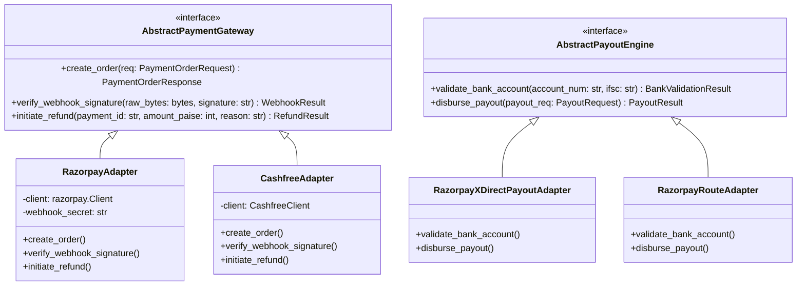

# Gadispot (formerly SmartPark Exchange) — High-Level System Architecture Specification

> **Document Version:** 2.3.0  
> **Date:** 2026-10-31  
> **Authors:** Principal Software Architect, Senior Backend Architect, DevOps Lead  
> **Target Deployment:** Cloud-Hosted Modular Monolith (AWS Mumbai / GCP Mumbai)  
> **Status:** Approved Engineering Specification (V2.3 Harmonized)  

---

## 1. Architectural Style: The Pragmatic Modular Monolith

SmartPark Exchange rejects premature microservice decomposition for its MVP. Early-stage microservices introduce catastrophic operational friction: distributed transaction sagas, eventual consistency race conditions across booking and payment boundaries, network serialization overhead, and multi-repository deployment complexity.

Instead, SmartPark is architected as an **In-Process Modular Monolith** built on **Python FastAPI**.

```
+---------------------------------------------------------------------------------------------------+
|                                  SMARTPARK EXCHANGE SYSTEM BOUNDARY                               |
+---------------------------------------------------------------------------------------------------+
|                                                                                                   |
|   +-------------------------------------------------------------------------------------------+   |
|   |                         SINGLE CROSS-PLATFORM FLUTTER MOBILE APP                          |   |
|   |         [ Driver Shell ]    [ Space Owner Shell ]    [ Guard Scanner ]    [ Ops View ]    |   |
|   +---------------------------------------------+---------------------------------------------+   |
|                                                 | HTTPS / TLS 1.3 (JSON REST API)                 |
|                                                 v                                                 |
|   +-------------------------------------------------------------------------------------------+   |
|   |                         FASTAPI MODULAR MONOLITH (CONTAINERIZED)                          |   |
|   |                                                                                           |   |
|   |   +-------------------+   +--------------------+   +-------------------+                  |   |
|   |   |   Auth & Users    |   |     Inventory      |   |   MSAI Engine     |                  |   |
|   |   |  - Firebase Admin |   |  - Spaces & Props  |   |  - Spatial Query  |                  |   |
|   |   |  - Role Scoping   |   |  - Schedules/Rates |   |  - Signal Sync    |                  |   |
|   |   +---------+---------+   +---------+----------+   +---------+---------+                  |   |
|   |             |                       |                        |                            |   |
|   |   +---------v---------+   +---------v----------+   +---------v---------+                  |   |
|   |   |  Unified Bookings |   |   Access Control   |   |   GPRP Recovery   |                  |   |
|   |   |  - 480s Holds     |   |  - Opaque Tokens   |   |  - Spatial Alt    |                  |   |
|   |   |  - Exclusion Lock |   |  - Guard Scanning  |   |  - Incident State |                  |   |
|   |   +---------+---------+   +---------+----------+   +---------+---------+                  |   |
|   |             |                       |                        |                            |   |
|   |   +---------v-----------------------v------------------------v---------+                  |   |
|   |   |                     PAYMENT & DOUBLE-ENTRY LEDGER                  |                  |   |
|   |   |  - Razorpay Orchestrator          - Balanced Journal Entries       |                  |   |
|   |   |  - Raw HMAC Webhook Verifier      - Weekly Payout Batch Engine     |                  |   |
|   |   +---------------------------------+----------------------------------+                  |   |
|   |                                     |                                                     |   |
|   |   +---------------------------------v----------------------------------+                  |   |
|   |   |                     DECOUPLED PROVIDER ADAPTERS                    |                  |   |
|   |   | [ PaymentGateway ]   [ PayoutEngine ]   [ SMSVerifier ]   [ Push ] |                  |   |
|   |   +---------------------------------+----------------------------------+                  |   |
|   +-------------------------------------+-----------------------------------------------------+   |
|                                         |                                                         |
|         +-------------------------------+-------------------------------+                         |
|         |                               |                               |                         |
|         v                               v                               v                         |
|   +------------+                +---------------+               +---------------+                 |
|   | POSTGRESQL |                |  REDIS CLUSTER|               | EXTERNAL SAAS |                 |
|   | - PostGIS  |                | - Cache Keys  |               | - Firebase    |                 |
|   | - btree_gist|               | - Rate Limits |               | - Razorpay    |                 |
|   | - GiST Lock|                | - Idempotency |               | - AWS S3      |                 |
|   +------------+                +---------------+               +---------------+                 |
|                                                                                                   |
+---------------------------------------------------------------------------------------------------+
```

### 1.1 In-Process Domain Encapsulation
- Domains interact via strongly typed Python service contracts, not internal HTTP hops.
- Cross-domain transactional workflows (e.g., Hold Creation -> Ledger Entry -> Reservation Commit) execute within a **single ACID database transaction**.
- A domain may only write to its designated tables.

---

## 2. Decoupled Provider Adapter Pattern

To insulate the core business logic from third-party vendor drift, deprecations, or vendor lock-in, all external SaaS providers sit behind strict abstract interfaces.



---

## 3. Security Perimeter & Network Topology

```
[ Driver / Guard Mobile App ]
             |
             | HTTPS (TLS 1.3 / Port 443)
             v
   [ AWS CloudFront CDN / WAF ]
   - DDoS Shield (AWS Shield Standard)
   - Geo-Restriction: Restrict traffic to India IP ranges
   - Rate Limiting: 100 req/min per IP
             |
             v
   [ Application Load Balancer (ALB) ]
             |
             | VPC Private Subnet
             v
   [ FastAPI Container Tasks (ECS Fargate / Cloud Run) ]
             |
             +---------> [ Managed PostgreSQL (RDS Multi-AZ) ] (Port 5432 - Private Subnet)
             |
             +---------> [ Managed Redis Cluster (ElastiCache) ] (Port 6379 - Private Subnet)
             |
             +---------> [ Encrypted Private S3 Bucket ] (Property Deeds & Photos)
```

### 3.1 Network Security Rules
- **No Public Database Access:** PostgreSQL and Redis instances have no public IP addresses and sit strictly within isolated VPC private subnets.
- **Egress-Only Internet Access:** Backend application workers reach external payment APIs (Razorpay, Firebase) via an AWS NAT Gateway.
- **Zero Secrets in Code:** Application secrets are injected at container boot from **AWS Secrets Manager** / **GCP Secret Manager**.

---

## 4. Scalability & High-Availability Strategy

1. **Horizontal Backend Auto-Scaling:** FastAPI containers are completely stateless. Container tasks scale horizontally on ECS Fargate based on CPU utilization (>60%) and concurrent request count.
2. **Database Read Replicas (P1):** All search discovery queries (`POST /spaces/search`) are read-heavy geospatial queries routed to read replicas; mutating reservation inserts execute exclusively on the primary database writer.
3. **Connection Pooling:** Async database connections are pooled using `asyncpg` with a minimum pool size of 20 and maximum of 80 connections per container task, managed behind PgBouncer.
