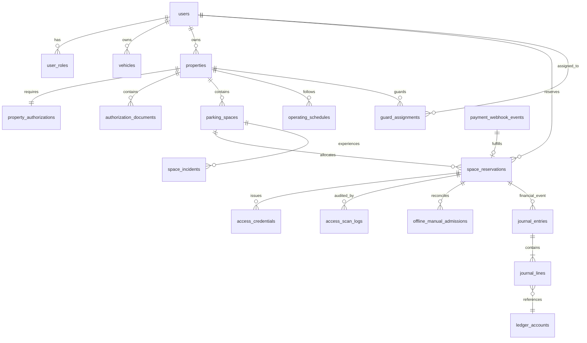

# Gadispot (formerly SmartPark Exchange) — Comprehensive Database & Data Architecture Specification (V2.3)

> **Document Version:** 2.3.0  
> **Date:** October 31, 2026  
> **Authors:** Database Architect, Principal Software Architect, Senior Backend Engineer  
> **Target Database Engine:** PostgreSQL 16 with PostGIS and `btree_gist`  
> **Status:** Authoritative Engineering Design (Targeted Revision V2.3)  

---

## 1. Schema Design Philosophy

The SmartPark database architecture is engineered for **strict transaction consistency**, **mathematical concurrency exclusion**, **double-entry ledger auditability**, and **high-performance geospatial queries**.

### Non-Negotiable Database Invariants
1. **Engine-Level Concurrency Exclusion:** Double-bookings and overlapping active holds are prevented at the storage engine layer using PostgreSQL range types (`tstzrange`) and GiST exclusion constraints (`EXCLUDE USING gist`). Redis is strictly read-only and ephemeral.
2. **Two-Tier Deterministic Expiration:** Stale holds are purged out of the partial exclusion index via scheduled background worker transactions and inline opportunistic sweeps. The hold lifespan is strictly 480 seconds (8 minutes).
3. **True Double-Entry Ledger:** All financial movements are tracked across `journal_entries` and `journal_lines`. Unbalanced transactions are rejected by database triggers enforcing $\sum \text{Debits} = \sum \text{Credits}$ and a minimum of 2 lines.
4. **Durable Webhook Idempotency:** Payment gateway events are deduplicated via unique database constraints on `payment_webhook_events`.
5. **Explicit Credential Lifecycle & Privacy:** Separate `ENTRY` and `EXIT` tokens with 128-bit cryptographic entropy. Underground basement admissions are recorded as controlled manual exceptions with a mandatory 7-day photo purge policy.

---

## 2. Entity-Relationship Architecture



---

## 3. Comprehensive DDL Specification

```sql
-- ============================================================================
-- 1. EXTENSIONS & ENUMS
-- ============================================================================
CREATE EXTENSION IF NOT EXISTS "uuid-ossp";
CREATE EXTENSION IF NOT EXISTS "btree_gist";
CREATE EXTENSION IF NOT EXISTS "postgis";

-- User Roles
CREATE TYPE user_role_enum AS ENUM ('DRIVER', 'OWNER', 'GUARD', 'OPERATIONS', 'ADMIN');

-- Property & Authorization
CREATE TYPE property_type_enum AS ENUM ('RESIDENTIAL_DRIVEWAY', 'APARTMENT_SOCIETY', 'COMMERCIAL_BUILDING', 'OPEN_PLOT');
CREATE TYPE authorization_status_enum AS ENUM ('DRAFT', 'PENDING_REVIEW', 'APPROVED', 'REJECTED', 'SUSPENDED');
CREATE TYPE document_type_enum AS ENUM ('PROPERTY_TAX_RECEIPT', 'SALE_DEED', 'ELECTRICITY_BILL', 'SOCIETY_NOC', 'LEASE_AGREEMENT', 'COMMERCIAL_CONCESSION');

-- Spaces & Vehicles
CREATE TYPE vehicle_category_enum AS ENUM (
    'TWO_WHEELER',
    'HATCHBACK',
    'SEDAN',
    'SUV',
    'EV_FOUR_WHEELER',
    'EV_TWO_WHEELER'
);
CREATE TYPE space_type_enum AS ENUM ('COVERED', 'OPEN', 'BASEMENT');

-- Reservations & Sessions
CREATE TYPE reservation_type_enum AS ENUM (
    'TEMPORARY_HOLD',
    'CONFIRMED_BOOKING',
    'ACTIVE_SESSION',
    'MAINTENANCE_BLOCK',
    'OWNER_BLACKOUT'
);

CREATE TYPE reservation_status_enum AS ENUM (
    'ACTIVE_HOLD',
    'EXPIRED_HOLD',
    'CONFIRMED',
    'ACTIVE_SESSION',
    'COMPLETED',
    'CANCELLED_BY_DRIVER',
    'CANCELLED_BY_OWNER',
    'NO_SHOW',
    'ARRIVAL_FAILED',
    'REPLACED',
    'RELEASED_UNFULFILLABLE'
);

-- Multi-Stage Refund Tracking (Canonical 6-Stage Lifecycle)
CREATE TYPE refund_status_enum AS ENUM (
    'NONE',
    'REFUND_ELIGIBLE',          -- Qualification verified against cancellation or recovery policy
    'REFUND_REQUESTED',         -- Queued for gateway API execution in outbox
    'GATEWAY_ACCEPTED',         -- Gateway acknowledged refund request with refund_id
    'REFUND_PROCESSING',        -- Gateway processing on banking rails
    'REFUND_SETTLED',           -- Settlement confirmed via gateway webhook with bank UTR
    'REFUND_FAILED'             -- Gateway or bank rail rejected refund; requires manual ops review
);

-- Access Credentials
CREATE TYPE token_type_enum AS ENUM ('ENTRY', 'EXIT');
CREATE TYPE token_status_enum AS ENUM ('ISSUED', 'ACTIVE', 'CONSUMED', 'REVOKED', 'EXPIRED');

-- Financial Double-Entry
CREATE TYPE account_type_enum AS ENUM ('ASSET', 'LIABILITY', 'EQUITY', 'REVENUE', 'EXPENSE');
CREATE TYPE journal_status_enum AS ENUM ('DRAFT', 'POSTED', 'VOIDED');
CREATE TYPE entry_side_enum AS ENUM ('DEBIT', 'CREDIT');

-- ============================================================================
-- 2. CORE USERS & VEHICLES
-- ============================================================================
CREATE TABLE users (
    id UUID PRIMARY KEY DEFAULT gen_random_uuid(),
    phone_number VARCHAR(16) NOT NULL UNIQUE, -- E.164 (+919876543210)
    full_name VARCHAR(128) NOT NULL,
    email VARCHAR(255),
    is_active BOOLEAN NOT NULL DEFAULT TRUE,
    created_at TIMESTAMPTZ NOT NULL DEFAULT NOW(),
    updated_at TIMESTAMPTZ NOT NULL DEFAULT NOW()
);
CREATE INDEX idx_users_phone ON users(phone_number);

CREATE TABLE user_roles (
    id UUID PRIMARY KEY DEFAULT gen_random_uuid(),
    user_id UUID NOT NULL REFERENCES users(id) ON DELETE CASCADE,
    role user_role_enum NOT NULL,
    created_at TIMESTAMPTZ NOT NULL DEFAULT NOW(),
    UNIQUE(user_id, role)
);

CREATE TABLE vehicles (
    id UUID PRIMARY KEY DEFAULT gen_random_uuid(),
    driver_id UUID NOT NULL REFERENCES users(id) ON DELETE CASCADE,
    registration_plate VARCHAR(32) NOT NULL,
    vehicle_category vehicle_category_enum NOT NULL,
    make_model VARCHAR(64),
    is_ev BOOLEAN NOT NULL DEFAULT FALSE,
    is_primary BOOLEAN NOT NULL DEFAULT FALSE,
    created_at TIMESTAMPTZ NOT NULL DEFAULT NOW(),
    updated_at TIMESTAMPTZ NOT NULL DEFAULT NOW(),
    UNIQUE(driver_id, registration_plate)
);
CREATE INDEX idx_vehicles_driver ON vehicles(driver_id);

-- ============================================================================
-- 3. PROPERTIES & INVENTORY SPACES
-- ============================================================================
CREATE TABLE properties (
    id UUID PRIMARY KEY DEFAULT gen_random_uuid(),
    owner_id UUID NOT NULL REFERENCES users(id) ON DELETE RESTRICT,
    title VARCHAR(128) NOT NULL,
    property_type property_type_enum NOT NULL,
    address_line TEXT NOT NULL,
    city VARCHAR(64) NOT NULL DEFAULT 'Bengaluru',
    postal_code VARCHAR(16) NOT NULL,
    
    -- Geospatial Point (WGS 84, SRID 4326)
    location GEOMETRY(Point, 4326) NOT NULL,
    
    max_advance_days INT NOT NULL DEFAULT 7,
    max_booking_hours INT NOT NULL DEFAULT 24, -- Configurable by property
    is_active BOOLEAN NOT NULL DEFAULT FALSE,
    created_at TIMESTAMPTZ NOT NULL DEFAULT NOW(),
    updated_at TIMESTAMPTZ NOT NULL DEFAULT NOW()
);
CREATE INDEX idx_properties_location ON properties USING gist (location);
CREATE INDEX idx_properties_owner ON properties(owner_id);

CREATE TABLE property_authorizations (
    id UUID PRIMARY KEY DEFAULT gen_random_uuid(),
    property_id UUID NOT NULL UNIQUE REFERENCES properties(id) ON DELETE CASCADE,
    status authorization_status_enum NOT NULL DEFAULT 'DRAFT',
    pan_number VARCHAR(16),
    gstin VARCHAR(32),
    reviewer_notes TEXT,
    reviewed_by UUID REFERENCES users(id),
    reviewed_at TIMESTAMPTZ,
    created_at TIMESTAMPTZ NOT NULL DEFAULT NOW()
);

CREATE TABLE parking_spaces (
    id UUID PRIMARY KEY DEFAULT gen_random_uuid(),
    property_id UUID NOT NULL REFERENCES properties(id) ON DELETE CASCADE,
    space_label VARCHAR(32) NOT NULL,
    space_type space_type_enum NOT NULL DEFAULT 'COVERED',
    
    -- Physical Dimensions & Specifications
    vehicle_category vehicle_category_enum NOT NULL,
    length_meters NUMERIC(4,2) NOT NULL DEFAULT 4.80,
    width_meters NUMERIC(4,2) NOT NULL DEFAULT 2.40,
    height_clearance_meters NUMERIC(4,2) NOT NULL DEFAULT 2.10,
    has_ev_charging BOOLEAN NOT NULL DEFAULT FALSE,
    
    base_hourly_rate_paise BIGINT NOT NULL CHECK (base_hourly_rate_paise > 0),
    is_active BOOLEAN NOT NULL DEFAULT TRUE,
    created_at TIMESTAMPTZ NOT NULL DEFAULT NOW(),
    updated_at TIMESTAMPTZ NOT NULL DEFAULT NOW(),
    UNIQUE(property_id, space_label)
);
CREATE INDEX idx_spaces_property ON parking_spaces(property_id);

-- ============================================================================
-- 4. UNIFIED CONCURRENCY RESERVATIONS TABLE
-- ============================================================================
CREATE TABLE space_reservations (
    id UUID PRIMARY KEY DEFAULT gen_random_uuid(),
    parking_space_id UUID NOT NULL REFERENCES parking_spaces(id) ON DELETE RESTRICT,
    driver_id UUID NOT NULL REFERENCES users(id) ON DELETE RESTRICT,
    vehicle_id UUID NOT NULL REFERENCES vehicles(id) ON DELETE RESTRICT,
    
    -- Temporal Range: [start_time, end_time) with timezone
    time_window TSTZRANGE NOT NULL,
    
    reservation_type reservation_type_enum NOT NULL,
    status reservation_status_enum NOT NULL,
    
    -- Hold Lifespan (strictly 480 seconds from creation)
    hold_expires_at TIMESTAMPTZ,
    
    -- Payment Gateway Correlation
    payment_order_id VARCHAR(64),
    payment_transaction_id VARCHAR(64),
    booking_reference VARCHAR(32) NOT NULL UNIQUE,
    idempotency_key VARCHAR(64) UNIQUE,
    
    -- Multi-Stage Refund Tracking
    refund_status refund_status_enum NOT NULL DEFAULT 'NONE',
    refund_gateway_id VARCHAR(64),
    refund_arn_utr VARCHAR(64),
    refund_initiated_at TIMESTAMPTZ,
    refund_completed_at TIMESTAMPTZ,
    refund_failure_reason TEXT,
    
    created_at TIMESTAMPTZ NOT NULL DEFAULT NOW(),
    updated_at TIMESTAMPTZ NOT NULL DEFAULT NOW(),

    CONSTRAINT chk_hold_expiration CHECK (
        (status != 'ACTIVE_HOLD') OR (hold_expires_at IS NOT NULL)
    ),
    CONSTRAINT chk_positive_time_window CHECK (
        lower(time_window) < upper(time_window)
    ),

    -- ENGINE-LEVEL GIST EXCLUSION CONSTRAINT
    CONSTRAINT prevent_overlapping_active_reservations
    EXCLUDE USING gist (
        parking_space_id WITH =,
        time_window WITH &&
    ) WHERE (status IN ('ACTIVE_HOLD', 'CONFIRMED', 'ACTIVE_SESSION', 'MAINTENANCE_BLOCK', 'OWNER_BLACKOUT'))
);

CREATE INDEX idx_reservations_space_time ON space_reservations USING gist (parking_space_id, time_window);
CREATE INDEX idx_reservations_status ON space_reservations(status);
CREATE INDEX idx_reservations_hold_expiry ON space_reservations(hold_expires_at) WHERE status = 'ACTIVE_HOLD';
CREATE INDEX idx_reservations_driver ON space_reservations(driver_id);

-- ============================================================================
-- 5. ACCESS CREDENTIALS & CONTROLLED MANUAL ADMISSION
-- ============================================================================
CREATE TABLE access_credentials (
    id UUID PRIMARY KEY DEFAULT gen_random_uuid(),
    reservation_id UUID NOT NULL REFERENCES space_reservations(id) ON DELETE CASCADE,
    token_type token_type_enum NOT NULL,
    opaque_token VARCHAR(64) NOT NULL UNIQUE,
    status token_status_enum NOT NULL DEFAULT 'ISSUED',
    valid_from TIMESTAMPTZ NOT NULL,
    valid_until TIMESTAMPTZ NOT NULL,
    consumed_at TIMESTAMPTZ,
    consumed_by_guard_id UUID REFERENCES users(id),
    created_at TIMESTAMPTZ NOT NULL DEFAULT NOW()
);
CREATE INDEX idx_access_credentials_lookup ON access_credentials(opaque_token);
CREATE INDEX idx_access_credentials_res ON access_credentials(reservation_id, token_type);

CREATE TABLE offline_manual_admissions (
    id UUID PRIMARY KEY DEFAULT gen_random_uuid(),
    property_id UUID NOT NULL REFERENCES properties(id),
    guard_id UUID NOT NULL REFERENCES users(id),
    vehicle_plate VARCHAR(32) NOT NULL,
    driver_phone_last4 VARCHAR(4),
    photo_s3_key TEXT NOT NULL,
    photo_purge_at TIMESTAMPTZ NOT NULL DEFAULT (NOW() + INTERVAL '7 days'), -- Automated 7-day privacy purge
    reason_code VARCHAR(32) NOT NULL,
    device_fingerprint VARCHAR(128) NOT NULL,
    event_signature VARCHAR(128) NOT NULL,
    
    admitted_at TIMESTAMPTZ NOT NULL,
    synced_at TIMESTAMPTZ,
    
    reconciliation_status VARCHAR(32) NOT NULL DEFAULT 'PENDING_SYNC',
    matched_reservation_id UUID REFERENCES space_reservations(id),
    conflict_details TEXT,
    
    created_at TIMESTAMPTZ NOT NULL DEFAULT NOW()
);
CREATE INDEX idx_offline_admissions_status ON offline_manual_admissions(reconciliation_status);
CREATE INDEX idx_offline_admissions_purge ON offline_manual_admissions(photo_purge_at) WHERE reconciliation_status = 'RECONCILED';

-- ============================================================================
-- 6. DOUBLE-ENTRY GENERAL LEDGER & IDEMPOTENCY
-- ============================================================================
CREATE TABLE payment_webhook_events (
    id UUID PRIMARY KEY DEFAULT gen_random_uuid(),
    gateway_name VARCHAR(32) NOT NULL,
    gateway_event_id VARCHAR(128) NOT NULL,
    event_type VARCHAR(64) NOT NULL,
    payload JSONB NOT NULL,
    status VARCHAR(32) NOT NULL DEFAULT 'RECEIVED',
    processed_at TIMESTAMPTZ,
    created_at TIMESTAMPTZ NOT NULL DEFAULT NOW(),
    CONSTRAINT uq_gateway_event UNIQUE (gateway_name, gateway_event_id)
);
CREATE INDEX idx_webhook_status ON payment_webhook_events(status);

CREATE TABLE outbox_events (
    id UUID PRIMARY KEY DEFAULT gen_random_uuid(),
    event_type VARCHAR(64) NOT NULL,
    payload JSONB NOT NULL,
    status VARCHAR(32) NOT NULL DEFAULT 'PENDING',
    created_at TIMESTAMPTZ NOT NULL DEFAULT NOW(),
    processed_at TIMESTAMPTZ
);
CREATE INDEX idx_outbox_pending ON outbox_events(status, created_at) WHERE status = 'PENDING';

CREATE TABLE ledger_accounts (
    account_code VARCHAR(16) PRIMARY KEY,
    account_name VARCHAR(128) NOT NULL,
    account_type account_type_enum NOT NULL,
    normal_balance VARCHAR(8) NOT NULL CHECK (normal_balance IN ('DEBIT', 'CREDIT')),
    description TEXT,
    is_active BOOLEAN NOT NULL DEFAULT TRUE,
    created_at TIMESTAMPTZ NOT NULL DEFAULT NOW()
);

CREATE TABLE journal_entries (
    id UUID PRIMARY KEY DEFAULT gen_random_uuid(),
    journal_number VARCHAR(32) NOT NULL UNIQUE,
    entry_date DATE NOT NULL DEFAULT CURRENT_DATE,
    transaction_reference VARCHAR(64) NOT NULL,
    transaction_type VARCHAR(32) NOT NULL,
    currency VARCHAR(3) NOT NULL DEFAULT 'INR',
    posting_status journal_status_enum NOT NULL DEFAULT 'DRAFT',
    reversal_of_journal_id UUID REFERENCES journal_entries(id),
    created_at TIMESTAMPTZ NOT NULL DEFAULT NOW(),
    posted_at TIMESTAMPTZ
);

CREATE TABLE journal_lines (
    id UUID PRIMARY KEY DEFAULT gen_random_uuid(),
    journal_id UUID NOT NULL REFERENCES journal_entries(id) ON DELETE RESTRICT,
    line_number INT NOT NULL,
    account_code VARCHAR(16) NOT NULL REFERENCES ledger_accounts(account_code),
    entry_side entry_side_enum NOT NULL,
    amount_in_paise BIGINT NOT NULL CHECK (amount_in_paise > 0),
    description TEXT,
    CONSTRAINT uq_journal_line UNIQUE (journal_id, line_number)
);

CREATE INDEX idx_journal_lines_journal ON journal_lines(journal_id);
CREATE INDEX idx_journal_lines_account ON journal_lines(account_code);
CREATE INDEX idx_journal_entries_reference ON journal_entries(transaction_reference);

-- TRIGGER: ENFORCE BALANCED JOURNAL POSTING (Debits == Credits AND >= 2 lines with row locking)
CREATE OR REPLACE FUNCTION fn_verify_journal_balance()
RETURNS TRIGGER AS $$
DECLARE
    v_total_debits BIGINT;
    v_total_credits BIGINT;
    v_line_count INT;
BEGIN
    IF NEW.posting_status = 'POSTED' AND (OLD.posting_status IS NULL OR OLD.posting_status != 'POSTED') THEN
        -- Acquire exclusive lock on lines to serialize against concurrent in-flight line insertions
        PERFORM 1 FROM journal_lines WHERE journal_id = NEW.id FOR UPDATE;

        SELECT 
            COALESCE(SUM(CASE WHEN entry_side = 'DEBIT' THEN amount_in_paise ELSE 0 END), 0),
            COALESCE(SUM(CASE WHEN entry_side = 'CREDIT' THEN amount_in_paise ELSE 0 END), 0),
            COUNT(*)
        INTO v_total_debits, v_total_credits, v_line_count
        FROM journal_lines
        WHERE journal_id = NEW.id;

        IF v_line_count < 2 THEN
            RAISE EXCEPTION 'Cannot post journal entry %: Must contain at least 2 lines (found %)', NEW.id, v_line_count;
        END IF;

        IF v_total_debits != v_total_credits THEN
            RAISE EXCEPTION 'Journal entry % does not balance! Total Debits: % paise, Total Credits: % paise',
                NEW.id, v_total_debits, v_total_credits;
        END IF;

        NEW.posted_at := CLOCK_TIMESTAMP();
    END IF;

    RETURN NEW;
END;
$$ LANGUAGE plpgsql;

CREATE TRIGGER trg_verify_journal_balance
BEFORE UPDATE ON journal_entries
FOR EACH ROW
EXECUTE FUNCTION fn_verify_journal_balance();

-- TRIGGER: IMMUTABILITY OF POSTED JOURNALS
CREATE OR REPLACE FUNCTION fn_prevent_posted_journal_modification()
RETURNS TRIGGER AS $$
BEGIN
    IF OLD.posting_status = 'POSTED' THEN
        RAISE EXCEPTION 'Immutable Ledger Violation: Posted journal % cannot be modified. Post a reversing entry instead.', OLD.id;
    END IF;
    RETURN NEW;
END;
$$ LANGUAGE plpgsql;

CREATE TRIGGER trg_prevent_posted_modification
BEFORE UPDATE OR DELETE ON journal_entries
FOR EACH ROW
EXECUTE FUNCTION fn_prevent_posted_journal_modification();

-- TRIGGER: IMMUTABILITY OF POSTED JOURNAL LINES & PARENT LOCKING
CREATE OR REPLACE FUNCTION fn_prevent_posted_journal_line_modification()
RETURNS TRIGGER AS $$
DECLARE
    v_status journal_status_enum;
    v_parent_id UUID;
BEGIN
    v_parent_id := COALESCE(NEW.journal_id, OLD.journal_id);

    -- Acquire row share lock on parent journal entry to serialize line mutation against posting status transitions
    SELECT posting_status INTO v_status
    FROM journal_entries
    WHERE id = v_parent_id
    FOR SHARE;

    IF v_status IS NULL THEN
        RAISE EXCEPTION 'Foreign Key Violation: Parent journal entry % does not exist', v_parent_id;
    END IF;

    IF v_status = 'POSTED' THEN
        RAISE EXCEPTION 'Immutable Ledger Violation: Cannot insert, update, or delete lines on POSTED journal %', v_parent_id;
    END IF;

    RETURN COALESCE(NEW, OLD);
END;
$$ LANGUAGE plpgsql;

CREATE TRIGGER trg_prevent_posted_line_modification
BEFORE INSERT OR UPDATE OR DELETE ON journal_lines
FOR EACH ROW
EXECUTE FUNCTION fn_prevent_posted_journal_line_modification();
```
